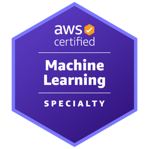

# Kajol Shah

**Integration Engineer at TransPerfect** · AI/ML · LLMs & Generative AI · Data Engineering · Analytics
New York City, NY · Building data and AI solutions since 2018

---

## About

I'm an engineer with 8+ years of experience across AI/ML, data engineering, and systems integration, currently working as an Integration Engineer at TransPerfect in New York City. I take data and AI work from raw data to production. My work spans the full lifecycle: designing data pipelines, analyzing and visualizing data to find what matters, building and evaluating machine learning models, and, more recently, developing LLM-powered applications such as retrieval-augmented generation (RAG) systems and AI assistants.

I care about solutions that are reliable, measurable, and useful to the people who depend on them, and I enjoy explaining technical work clearly to both engineers and business stakeholders. I also write about ML and AI on [Medium](https://medium.com/@kajolshah).

## What I Work On

- **LLMs & Generative AI:** RAG pipelines, prompt engineering, LLM evaluation, fine-tuning, embeddings and vector search, agentic workflows
- **Machine Learning & Deep Learning:** Classification, regression, forecasting, NLP, computer vision, and model evaluation
- **Data Engineering:** Batch and streaming ETL/ELT pipelines, data modeling, data quality, and large-scale processing with Spark
- **Data Analysis & Visualization:** Exploratory analysis, statistical testing, KPI dashboards, and data storytelling for decision-makers
- **MLOps & Deployment:** Model serving via APIs, containerization, experiment tracking, and monitoring in cloud environments

## Professional Experience

**Currently:** Integration Engineer at TransPerfect, New York City

8+ years across AI/ML engineering, data engineering, systems integration, and data analytics (2018–present). Highlights include:

- Integrating enterprise systems, APIs, and data flows so that applications and AI services work together reliably
- Building end-to-end machine learning solutions, from data ingestion and feature engineering to deployment and monitoring
- Developing LLM-based applications that connect language models to internal data sources
- Designing scalable data pipelines and warehouses that power analytics and ML workloads
- Creating dashboards and analyses that turned complex data into clear business recommendations

For full details on roles and impact, see my [LinkedIn](https://www.linkedin.com/in/kajol-t-shah/).

## Featured Projects

| Project | Description | Tech |
|---|---|---|
| [Multi-Collection Style Transfer](https://github.com/kajolshah310/Style_transfer_using_CycleGAN) | Image-to-image style transfer across multiple art collections using CycleGAN | Python, Deep Learning, GANs |
| [ML on Big Data with PySpark](https://github.com/kajolshah310/Machine-Learning-using-PySpark-and-MLLib) | Machine learning models trained at scale with Apache Spark and MLlib | PySpark, MLlib |
| [Fake News Classification](https://github.com/kajolshah310/fake_news_classification) | Text classification comparing classical ML and deep learning approaches | NLP, Python |
| [CIFAR-10 Image Classification](https://github.com/kajolshah310/cifar10_image_classification) | Image classification with fully connected neural networks | Keras, TensorFlow |
| [Hazardous Asteroid Prediction](https://github.com/kajolshah310/hazardous_asteroids_prediction) | Predicting potentially hazardous asteroids from orbital data | Python, scikit-learn |
| [Image Transformations in CV](https://github.com/kajolshah310/basic_image_transformations_in_CV) | Core image processing and transformation techniques | OpenCV, Python |

## Tech Stack

**Languages:** Python, SQL, R, C++
**LLMs & GenAI:** OpenAI API, Hugging Face Transformers, LangChain, LlamaIndex, vector databases (FAISS, Pinecone, Chroma)
**ML / DL:** PyTorch, TensorFlow, Keras, scikit-learn, XGBoost, OpenCV, spaCy, NLTK
**Data Engineering:** Apache Spark (PySpark), Apache Airflow, Kafka, dbt, Snowflake, Databricks, PostgreSQL, MySQL
**Analysis & Visualization:** Pandas, NumPy, Matplotlib, Seaborn, Plotly, Tableau, Power BI
**Cloud & MLOps:** AWS, Azure, Docker, FastAPI, MLflow, Git, CI/CD

## Certifications

  
  
  
  

- [AWS Certified Machine Learning – Specialty](https://www.credly.com/badges/7f809128-b935-4b72-b3dc-e8f5364781dd)
- AWS Certified Cloud Practitioner
- Microsoft Certified: Azure Fundamentals
- Microsoft Certified: Azure AI Fundamentals

## Let's Connect

I'm happy to talk about LLMs, machine learning, data engineering, or potential roles and collaborations. Reach me on [LinkedIn](https://www.linkedin.com/in/kajol-t-shah/) or by [email](mailto:kajolshahsm@gmail.com).
